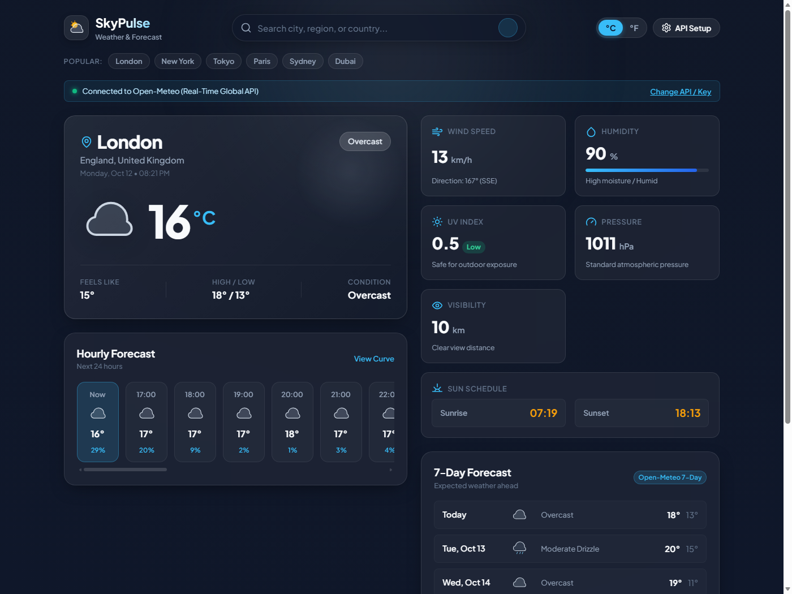

# SkyPulse 2.0 — The Living Atmosphere 🌦️✨

A cinematic, data-driven, world-class weather observatory and 100-country atmospheric intelligence platform built with semantic HTML5, modern CSS3, and JavaScript.



---

## 🌟 Visual Identity: The Atmospheric Aurora System

SkyPulse 2.0 embodies the **Atmospheric Aurora** design system:
- **Deep Midnight Navy:** `#070B16`
- **Atmospheric Blue:** `#0D1B2A`
- **Electric Cyan:** `#35D7FF`
- **Aurora Violet:** `#7967FF`
- **Soft Cloud White:** `#F4F7FF`
- **Muted Blue-Gray:** `#8E9EB5`

Featuring restrained glassmorphism, glowing translucent cards, ambient aurora mesh gradients, and condition-responsive atmospheric particles.

---

## 🚀 Key Features

### 1. 🌌 Living Atmospheric Simulator (Canvas Engine)
- Condition-aware particle canvas rendering ambient solar motes for sunny skies, angled precipitation streaks for rain, electric discharges for thunderstorms, drifting crystalline snowflakes for snow, and twinkling starfields for nocturnal atmospheres.
- Optimized 60 FPS performance with accessibility respect for reduced motion.

### 2. ⚡ Cinematic Weather Centerpiece
- **Oversized Typography:** High-impact temperature centerpiece with subtle cyan drop shadow.
- **Weather Mood Indicator:** Atmospheric mood badges summarizing real conditions (e.g. *Crisp & Radiant*, *Storm Alert Active*, *Nocturnal Starlit Serenity*).
- **One-Click Favorites:** Star button on the hero to save any city to browser `localStorage` and access via quick header pills.
- **High / Low & Feels-Like:** Real-time metrics updated instantly when switching between **°C / °F**.

### 3. 🧠 Weather Intelligence & 24h Storytelling Hub
- **Analytical Brief:** Generates concise human narratives from real 24-hour forecast data (peak temperatures, evening cooldown, precipitation windows).
- **Contextual Intelligence Cards:**
  - ☂️ **Umbrella Advisory:** Probability-based guidance for the upcoming 12 hours.
  - 🏃 **Outdoor Activity Rating:** Evaluates temperature, wind, and rain for running or cycling.
  - 💨 **Wind Dynamics:** Beaufort scale classification, cardinal compass bearing, and speed.
  - 🌡️ **Temperature Trajectory:** 24-hour warming or cooling trend predictions.

### 4. 📈 24-Hour Timeline & Spline Curve
- Horizontally scrollable 24-hour cards with precipitation probability (`%`) and current hour highlight.
- Interactive high-DPI canvas graph rendering smooth Bezier spline temperature curves with dual cyan-to-violet gradient fills.

### 5. 📅 7-Day Extended Forecast with Range Bars & Expandable Drawers
- **Temperature Range Bars:** Visual indicator displaying daily min-to-max temperature range relative to the entire week's scale.
- **Expandable Day Accordion:** Click any day to reveal morning, afternoon, evening, and night breakdowns with precipitation and UV index.

### 6. 🌍 100-Country Global Atmospheric Intelligence Center
- **Planetary Telemetry:** Real calculated metrics across 100 sovereign nations (warmest nation, coldest nation, dynamically computed global average temperature).
- **Segmented Distribution Bar:** Real-time breakdown of monitored nations currently Sunny, Cloudy, Rainy, Stormy, or Snowy.
- **Interactive World Weather Map:** Integrated with Leaflet and CartoDB Dark Matter tiles, rendering interactive temperature pins for 100 world capitals. Clicking any marker reveals telemetry and focuses that location into the main hero view!
- **Filter & Sort Toolbar:** Real-time search by country or capital, continent filtering (Europe, Asia, Americas, Africa, Oceania), and multi-criteria sorting.

### 7. ⚖️ City Comparison Matrix
- Compare 2 to 3 cities side-by-side in an interactive modal table covering temperature, condition, humidity, wind velocity, and coordinates.

### 8. 🛡️ Dual API Architecture & Firewall Resiliency
- **Open-Meteo Global API (Default):** Zero-key, 100% free, high precision.
- **OpenWeatherMap (OWM 2.5):** User API key support with graceful fail-safe fallback.
- **Local Proxy Endpoint (`/api/proxy`):** Bypasses strict campus/corporate firewall SSL inspection and CORS issues via Node.js agent.

---

## 🛠️ Quick Start

### 1. Launch Server
Double-click `start.bat` on Windows, or run:
```bash
node server.js
```

### 2. Open Application
Navigate to [**http://localhost:3000**](http://localhost:3000) in any modern browser.

---

## 📂 Project Architecture

```
weather-app/
├── assets/
│   └── preview.png          # UI preview banner
├── css/
│   └── style.css            # Atmospheric Aurora design system
├── js/
│   ├── api.js               # API service & normalization
│   ├── app.js               # Main application controller
│   ├── countries.js         # 100-country dataset & telemetry stats
│   └── icons.js             # SVG vector icon & dynamic loader library
├── index.html               # Semantic HTML5 layout
├── package.json             # Project metadata
├── server.js                # Node proxy server
└── start.bat                # Windows desktop launcher
```

---

*SkyPulse 2.0 • The Living Atmosphere*
